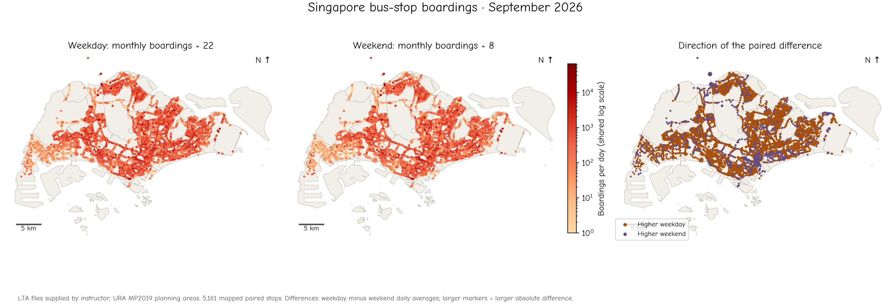
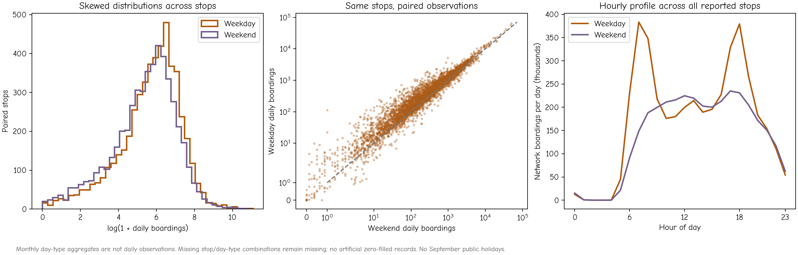

# Chapter 3: Statistical patterns and comparisons

Two places can look different on a map, and two groups can have different averages, without yet providing a clear answer to a statistical question. We need to know what was measured, what constitutes an observation, which comparison matters and what source of uncertainty a model is meant to represent. This chapter develops those decisions before introducing the calculations used to compare groups.

We use Singapore bus-stop boardings in September 2026 as a common example. The opening question is: **how does daily-average boarding activity differ between weekdays and weekends at the same stops?** A second question asks how weekday boarding distributions vary between stops with different functional labels. Both questions concern the same network, but their statistical designs differ.

## Read the source rows before choosing a test

The supplied passenger-volume file contains 202,959 records for 5,207 bus-stop codes. A record is a **stop × day type × hour aggregate across the month**. It is not the volume on an individual day. Summing the hourly tap-in volumes gives a stop's total boardings for each day type. We divide weekday totals by 22 and weekend totals by 8, the numbers of those days in September 2026. The official holiday calendar has no gazetted public holidays in that month.

For stop $i$, define

$$W_i=\frac{B_{i,W}}{22},\qquad E_i=\frac{B_{i,E}}{8},\qquad D_i=W_i-E_i.$$

The monthly totals $B_{i,W}$ and $B_{i,E}$ refer to different numbers of days. Comparing them directly would mix day-type behaviour with duration. The daily averages $W_i$ and $E_i$ remove that simple duration difference. They do not recover the distribution of boardings across individual days.

A total of 5,161 stops report both day types. These form our paired sample. The other 46 stops are not assigned invented zero values or included in the paired calculation. Five source records have no hour label; their zero boardings do not alter the boarding profiles. Their 13 alightings remain in the stop totals. We study boardings here, rather than adding boardings and alightings as if they counted distinct passengers.

*Figure 3.1. Weekday and weekend daily-average boardings use a common logarithmic colour scale. The third panel shows the direction of each stop's difference, with marker size reflecting magnitude. All 5,161 paired stops have coordinates. URA MP2019 planning areas provide the background.*

## Describe the observed differences first

| Across the 5,161 paired stops | Weekday | Weekend |
|---|---:|---:|
| Mean daily-average boardings per stop | 793.61 | 643.76 |
| Median daily-average boardings per stop | 369.14 | 273.25 |

The mean of the paired differences is 149.85 boardings per day, while their median is 62.92. A total of 4,300 stops have higher weekday values, 856 have higher weekend values and 5 are tied. These are descriptions of the supplied paired stops in this month. We can report them without first obtaining a p-value.

The much larger means than medians suggest a long upper tail. A small number of busy stops can strongly influence an average, so the mean and median describe different aspects of a distribution. Neither is automatically the better statistic: the choice follows the question.

*Figure 3.2. Distributions and paired scatter use the paired stops; hourly boarding profiles sum all reported stops. The transformed axes reveal the broad range of activity. They do not change which records are included.*

## What would an inference be about?

This snapshot is close to a census of reporting stops for a single month. If our target is exactly those paired stops in September, their observed average difference is already known from the data. A conventional standard error is not a measure of how uncertain that arithmetic is.

Inference requires a broader or model-based target: perhaps a population of comparable stop environments or an underlying process generating stop differences. It also requires assumptions about how observations vary and depend on each other. Adjacent stops share routes, neighbourhoods and passenger flows, so treating them as independent can be implausible. Generalising to other months would require temporal evidence, not simply a large number of stops within this month.

We use conventional tests as **conditional model demonstrations**, stating their assumptions and identifying where this example challenges them. The objective is to understand what each calculation answers and why its output needs geographical reasoning.

By the end of the chapter, you should be able to formulate a null hypothesis, distinguish independent and paired designs, interpret a t-test and an ANOVA, choose among common rank-based alternatives and separate an observed difference from a defensible inference.

**Self-check:** What additional data would you need to estimate day-to-day variability in weekday boardings? Why are 22 weekdays in an aggregate not 22 observed replicates?

## Sources and reproducibility

The source records are instructor-supplied LTA DataMall September 2026 passenger-volume and bus-stop extracts. See the [data definitions, preparation rules, numerical audit and offline figure scripts](https://github.com/wcchin/geo-stat-vis/blob/main/src/content/datasets/bus_ridership_202609/README.md). Maps use URA Master Plan 2019 planning areas.
