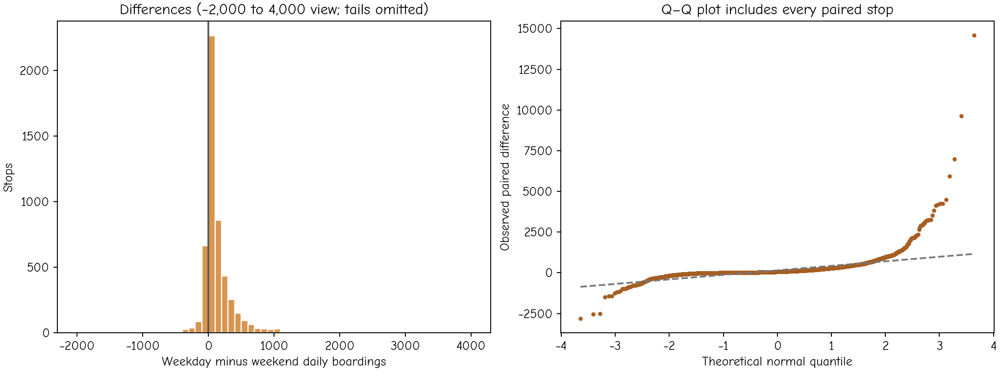

# 3.2 Comparing means with t-tests

A t-test compares a mean, or a difference of means, with a null value relative to an estimated standard error. Several tests share that idea, but they represent different designs. The first decision is whether the measurements are independent or linked through the same observational units.

| Design | Example question | Quantity being compared |
|---|---|---|
| One-sample | Does a defined stop population have mean weekday activity equal to a prespecified benchmark? | One mean minus the benchmark |
| Independent samples | Do two separately observed categories have different means? | Difference between group means |
| Paired samples | Does weekday activity differ from weekend activity at the same stops? | Mean of within-stop differences |

A benchmark must have a substantive justification. Choosing it after inspecting the data so that a test produces a desired result undermines its interpretation.

## The paired t-test

For our main question, each stop has two measurements. We first calculate $D_i=W_i-E_i$. The paired test is a one-sample t-test on these differences:

$$t=\frac{\overline{D}-\mu_{D,0}}{s_D/\sqrt{n}}.$$

The null value $\mu_{D,0}$ is zero for the equality-of-means question. The sample standard deviation $s_D$ describes variation among the stop differences. Under the usual independent, normally distributed differences model, the statistic follows a t distribution with $n-1$ degrees of freedom under the null.

Pairing matters because a stop with a large baseline level often remains busy on both day types. Subtracting its own weekend value retains that connection. The normality assumption for the conventional exact paired test concerns the **differences**, not a requirement that each of the two marginal distributions be normal.

*Figure 3.4. The histogram focuses on −2,000 to 4,000 daily boardings and omits more extreme differences from that panel. The Q–Q plot includes all paired differences and shows strong tail departures from a normal shape.*

## A calculation with its assumptions attached

For the 5,161 paired stops, the observed mean difference is 149.85 daily boardings and the standard deviation of differences is 434.25. If we temporarily impose the independent-stop model, the standard error is 6.04, the statistic is 24.79 and the degrees of freedom are 5,160. The two-sided p-value is approximately $2.85\times10^{-128}$.

Under that same model, the conventional 95% interval for the mean difference is approximately **138.00 to 161.70 boardings per day**. These calculations demonstrate how the test works. The p-value and interval do not account for connected routes and spatial dependence, and they do not quantify variation between individual days. The observed mean difference remains a valid description of the supplied stops even when the inferential model is questionable.

## Independent samples and Welch's test

If two groups contain different observational units, a paired test is inappropriate. A pooled two-sample t-test assumes a common population variance. Welch's t-test allows different variances and uses a different standard error and degrees-of-freedom approximation:

$$t_W=\frac{\overline{X}-\overline{Y}}{\sqrt{s_X^2/n_X+s_Y^2/n_Y}}.$$

For example, comparing weekday activity between stops labelled as interchanges and stops labelled as terminals would involve different stops. Their variability and group sizes differ greatly, so a pooled equal-variance calculation would need strong justification. Welch's method addresses unequal variances; it does not repair spatial dependence, classification error or an unclear target population.

## Transformations change the estimand

Taking a logarithm can reduce the influence of large observations. It also changes the quantity being compared. A mean difference on a log scale is not a difference in arithmetic mean boardings on the original scale. Adding one to accommodate zeros creates another specific transformation that should be stated and interpreted.

A transformation should serve a defensible question or model rather than be chosen merely to obtain a smaller p-value. Inspect both the original units, which communicate substantive size, and any transformed analysis used for modelling.

**Self-check:** Why is a paired t-test on weekdays versus weekends different from comparing their totals as two independent groups? Identify the observational unit and the source of replication in each proposed analysis.
