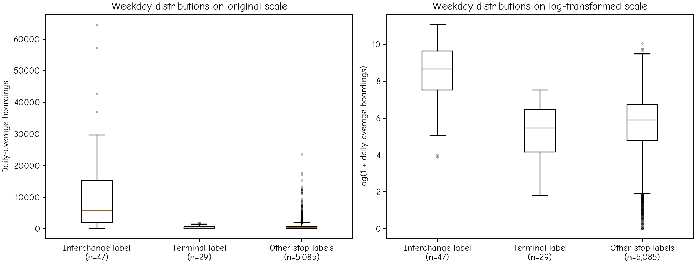

# 3.3 Comparing several means with ANOVA

Analysis of variance (ANOVA) compares differences among group means with variation within groups. In a one-way ANOVA, a single categorical factor defines the groups. The null hypothesis states that all population means are equal; the alternative is that at least one differs.

For $g$ groups,

$$H_0:\mu_1=\mu_2=\cdots=\mu_g.$$

The alternative does not state that every pair differs. An omnibus rejection therefore does not identify which groups differ or whether a difference is practically important.

## Define groups independently of the outcome

We use the stop descriptions to construct a transparent teaching proxy. Descriptions ending in “Int” form an **interchange-label** group; those ending in “Ter” form a **terminal-label** group; other descriptions form a third group. The rule is based on names, not on passenger volumes. It is not a fully verified inventory of operational stop functions, so the labels and their limitations remain visible.

Among the paired stops, the groups contain 47 interchange-label stops, 29 terminal-label stops and 5,085 other stops. Their weekday mean daily-average boardings are approximately 11,660.45, 492.14 and 694.89, respectively. Medians are 5,720.95, 235.23 and 365.14. The contrast between means and medians matters particularly for the interchange-label group.

Creating “low”, “medium” and “high” groups from the boarding volumes and then testing whether their mean boardings differ would build the result into the grouping rule. Independent categories make the comparison interpretable, although observational associations still do not establish causes.

*Figure 3.5. The same weekday data on original and log(1 + boardings) scales. Boxplots show medians, interquartile ranges and points beyond the whiskers. The groups differ greatly in size and variability; the name-based grouping is an explicit proxy.*

## Why compare variances to compare means?

Classical one-way ANOVA separates total squared variation into between-group and within-group components. If group $j$ has $n_j$ observations, mean $\overline{X}_j$ and overall mean $\overline{X}$, then

$$SS_B=\sum_{j=1}^{g}n_j(\overline{X}_j-\overline{X})^2,$$

$$SS_W=\sum_{j=1}^{g}\sum_{i=1}^{n_j}(X_{ij}-\overline{X}_j)^2.$$

The conventional statistic is

$$F=\frac{SS_B/(g-1)}{SS_W/(N-g)}.$$

The numerator reflects separation among means and the denominator reflects scatter within groups. Under independent normal errors with a common variance and the null hypothesis, the statistic has an F distribution with $g-1$ and $N-g$ degrees of freedom.

For this snapshot, the classical calculation gives F about 868.46. Welch's ANOVA, which allows unequal group variances and uses a different construction, gives F about 14.66 and a model-based p-value about 0.0000109. The large difference between these statistics illustrates the importance of variance assumptions when group sizes are highly unequal. The two statistics have different reference degrees of freedom and should not be compared as if they used the same scale of evidence.

Neither calculation accounts for spatial dependence. The original-scale distributions are strongly skewed and the group rule is a proxy. We therefore interpret these outputs as demonstrations of model sensitivity, alongside the observed summaries, rather than treating an omnibus test as a final conclusion about Singapore's transport system.

## Follow-up comparisons and multiplicity

An omnibus test can be followed by planned contrasts or appropriate post-hoc comparisons. If many comparisons are made, the probability of at least one false rejection can increase. A method such as Holm adjustment can control a familywise error criterion for valid component p-values. Tukey's approach is associated with an equal-variance ANOVA setting; unequal-variance comparisons require a suitable alternative, such as Games–Howell, with its own assumptions.

An adjustment does not fix an invalid independence model. Specify the family of comparisons and the substantive reason for making them before interpreting a collection of p-values.

## Repeated and mixed designs

Weekday and weekend measurements at the same stop are repeated measurements. With only those two conditions, the usual repeated-measures mean comparison corresponds to the paired t-test, and its F statistic equals the squared paired t statistic under the same model. It is not an independent one-way ANOVA on the two lists.

A mixed design could combine day type within stops with stop category between stops. Its interaction would ask whether the day-type difference varies by category. Such an analysis requires a model representing repeated measurements, group differences and any relevant dependence. Separate omnibus tests do not automatically answer the interaction question. More than two repeated conditions would also introduce additional covariance assumptions or corrections.

**Self-check:** Why is “the ANOVA is significant, therefore every interchange has higher ridership than every other stop” an incorrect interpretation?
