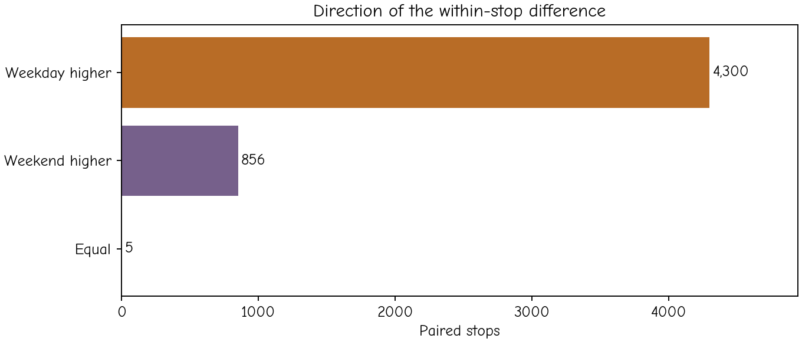

# 3.4 Non-parametric comparisons

Rank-based methods offer alternatives when an analysis of arithmetic means is not the intended question or when its distributional assumptions are unsuitable. They often use the order of observations rather than their full numerical magnitudes. That makes them less sensitive to extreme values in some settings, while changing what the test is about.

“Non-parametric” does not mean “without assumptions”. Independence, pairing, measurement scale and the interpretation of the null hypothesis still matter. A rank transformation also preserves the geography linking neighbouring stops, so it does not remove spatial dependence.

## Match the test to the design

| Design | Common alternative | Interpretation to check |
|---|---|---|
| Two independent groups | Mann–Whitney U / Wilcoxon rank-sum | Distributional or stochastic ordering; a median-shift interpretation requires additional shape assumptions |
| Two paired conditions | Wilcoxon signed-rank | Symmetry of the paired-difference distribution around zero under its null |
| Three or more independent groups | Kruskal–Wallis | Equality of distributions under its null; differences can involve more than medians |
| Three or more repeated conditions | Friedman | Within-unit ranks across conditions, with a complete suitable block design |

Mann–Whitney is not the paired signed-rank test. Applying an independent-groups rank test to weekday and weekend values would discard the within-stop connection, just as an independent t-test would.

## Paired signs and signed ranks

A simple description records the sign of each difference. In this dataset, 4,300 stops have a positive weekday-minus-weekend difference, 856 a negative difference and 5 an exact tie. Of the 5,156 non-tied pairs, approximately 83.40% are positive. If ties are included in the denominator, 83.32% of all pairs are positive. Both summaries are valid when their denominators are stated.

*Figure 3.6. Counting directions gives each stop one contribution, regardless of its difference in magnitude. This answers a different question from comparing mean differences.*

Under an illustrative independent-pairs sign-test null, positive and negative signs are equally likely among non-ties. That model does not require the size of differences to follow a normal distribution, but still needs an appropriate independence assumption and a clear treatment of ties.

Wilcoxon signed-rank uses both the signs and the ranks of absolute nonzero differences. Its usual location interpretation assumes a suitable symmetric difference distribution. Our Q–Q plot and tail behaviour motivate inspecting that assumption rather than selecting the test automatically because the original boardings are skewed.

The supplied source counts also create ties through aggregation. For numerical stability, the code constructs the paired differences from their integer numerator before dividing by 88, because dividing by 22 and by 8 can otherwise introduce tiny rounding differences. We state the zero convention used in the demonstration: `zero_method='wilcox'` drops zero differences from its ranking calculation. The five tied pairs remain in the descriptive summaries.

The conditional signed-rank and sign-test p-values are so small that the implementation returns numerical zero at floating-point precision. This is a computational limit, not a probability of exactly zero. We do not use those values to claim stronger substantive evidence than the design supports.

## Several groups and several kinds of difference

Kruskal–Wallis applied to the three stop-label groups gives H about 82.80 and a conditional p-value about $1.05\times10^{-18}$. It compares ranks across independent groups under its model. Calling this simply a “test of medians” would require additional assumptions about the distributional shapes. The boxplots show why that qualification matters.

A rank-based result and an ANOVA can disagree because they weight magnitudes differently and target different aspects of a distribution. Their agreement would not validate a shared, questionable independence assumption either.

**Self-check:** If a few very busy interchanges dominate the mean, what information is lost when replacing volumes with ranks? What information is retained, and which geographical dependence remains?
