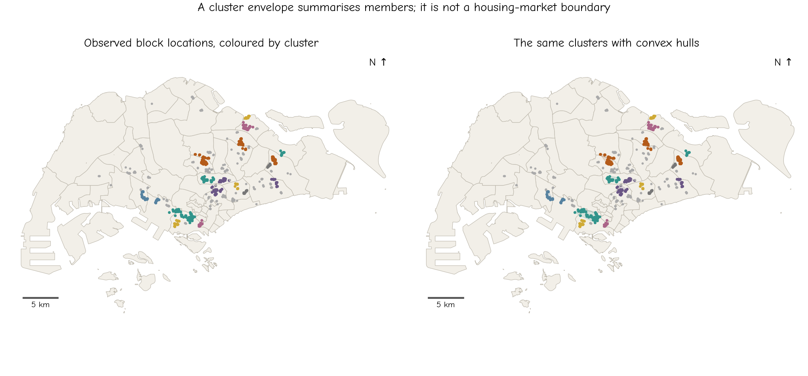
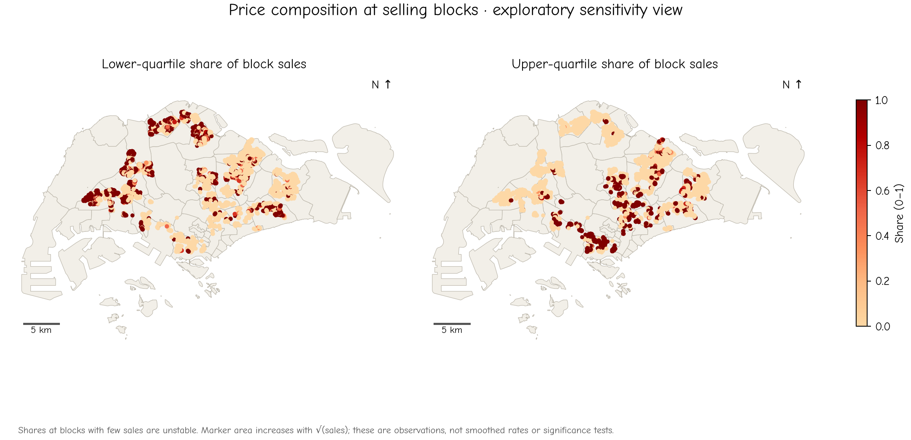

# 5.6 Visualising and interpreting spatial clusters

A clustering algorithm produces memberships. A map translates those memberships into a visual claim about geography. Point colours, filled surfaces and enclosing polygons each emphasise different aspects of the result. A useful display lets the reader distinguish observed positions from a graphical summary.

## Begin with the member points

Use point colours to show membership and a neutral symbol for observations labelled noise. Keep colour meanings explicit. Sequential colours suit ordered quantities such as intensity or price. Distinct cluster identifiers need categorical colours: there is no reason that cluster 4 should look “higher” than cluster 2.

Repeated transaction positions can hide one another. Size or count symbols can communicate co-location, but the legend must state whether the displayed quantity is transactions or distinct blocks. Random jitter makes overlap visible at the cost of inventing positions; we avoid it for this example.



*Figure 5.7. The 600 m DBSCAN result with `min_samples = 20`, shown first as observed block positions and then with convex hulls. Coincident positions are collapsed only for drawing hulls and member markers in this comparison; memberships were computed from all transactions.*

## Choose envelopes cautiously

A convex hull is the smallest convex polygon enclosing a group's points. It communicates broad extent, but it fills gaps between observations. A hull can include water, non-residential land and areas without any member transactions. It is not a detected boundary of a continuous housing market.

A standard deviational ellipse summarises centre, orientation and spread. Unless a separate statistical model and confidence construction are specified, it is not a confidence region. It can be a compact summary while overlooking irregular shapes or multiple concentrations within one group.

A Voronoi partition assigns each location to its nearest generating point or centre under the chosen metric. It is a division of space imposed by that distance rule. It does not establish observed catchments or the outer limits of a concentration. In particular, a centroid Voronoi diagram for k-means has a different meaning from a boundary traced around member points.

Contours and heatmaps communicate a continuous density surface. A displayed contour depends on both the smoothing and the selected level. Changing the contour level can make one surface appear to contain several separate patches or a connected region. Make those choices visible rather than allowing the outline to suggest a unique boundary.

## Return to the price question

The chapter's methods locate and group selected transactions. They have not established that expensive marks are unusually clustered conditional on all selling locations. One descriptive check is to compare the upper-group count at a block with the total count at that block.



*Figure 5.8. The observed fraction of each selling block's transactions in the lower or upper price group. Marker area increases with the square root of its sales count plus a constant. Shares based on very few sales are unstable; these are not smoothed estimates or significance maps.*

An all-upper share at a block with one sale has a different evidential basis from an all-upper share at a block with twenty sales. A local share also conditions on sales, not all flats or residents. It cannot be interpreted as the probability that a resident can afford a home there.

Price definitions matter too. When we replace total price with price per square metre and recalculate the quartiles, 879 transactions change lower/middle/upper group. Neither measure removes differences in remaining lease, floor or flat model. Explain which question the selected measure answers before interpreting its geography.

## Chapter synthesis

KDE smooths observations at a chosen scale. K-means partitions every observation around a specified number of centres. DBSCAN identifies density-connected groups while allowing noise labels. Their outputs differ because their questions and rules differ. A useful comparison explains those differences rather than treating the methods as competing tests of one unique map.

For a defensible description, state the observation and period, the price definition, the coordinate system, how repeated positions contribute, and the parameters that shape the result. Then separate the observed pattern from the explanation proposed for it. Formal evidence about whether nearby values are similar requires an explicitly defined inferential framework; the areal autocorrelation methods in Chapter 6 introduce one such framework with a different data representation.

**Final exercise:** Write a short interpretation of Figure 5.6 that includes its subset, observation unit, parameter settings and a sensitivity finding. End with one question the map cannot answer.

```{dropdown} Self-check feedback: Does a convex hull locate the true housing-market boundary?
No. It encloses member points and fills gaps, potentially including water or places with no observed sale.
```
