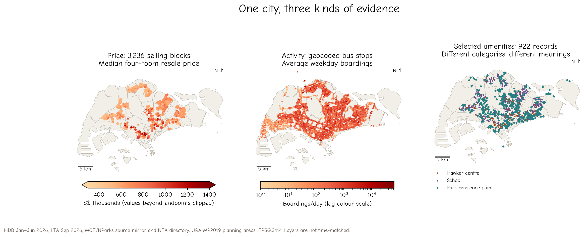

# 7.0 Geovisualisation: from spatial evidence to a story

Imagine that a friend is comparing places to live in Singapore. They ask a familiar question: “Is this neighbourhood convenient?” You could answer with a map of bus stops, a map of shops, or a map of resale prices. Each might be accurate. Each would answer a different question.

This chapter uses that ambiguity to connect spatial analysis with visual storytelling. We bring together the four-room HDB transactions introduced in Chapter 5, the bus activity examined in Chapter 3, and selected amenity locations. The purpose is to help a reader distinguish **price, nearby facilities and recorded transport activity**, then decide what further evidence they need. We do not try to rank neighbourhoods or predict a housing price premium.

Earlier chapters taught us to recognise patterns, specify study boundaries and question apparent clusters. Here, the analytical work becomes material for communication. A useful map makes the evidence inspectable; a useful sequence explains why the evidence matters. A reader should leave with a better question as well as a clearer picture.

## What you will learn

By the end of this chapter, you should be able to turn an analytical question into a short visual narrative for a specified audience; choose map components and visual hierarchy that support that narrative; distinguish a persuasive interpretation from a claim the data cannot support; and produce an accessible, reproducible sequence with an honest ending.

We borrow questions from advertising design: Who is this for? What familiar belief does it address? What tension makes the reader look again? What single idea should remain afterwards? These questions form a teaching framework for this chapter, rather than a named or validated advertising model. In research communication, the evidence sets the limits of the message. An engaging story cannot justify inventing a surprising finding.

## Our running example

The working question is: **When we call a neighbourhood convenient, which evidence are we using—and how does that relate to housing prices?** The imagined reader is a student or household comparing places, rather than a transport engineer or property valuer. This is an audience scenario, not a claim based on interviews with actual residents.

*Figure 7.1. Three views of Singapore, each retaining its own unit and meaning. Price colours show block medians, bus colours show average weekday boardings, and amenity symbols show categories. Similar-looking spatial concentrations do not establish a causal relationship. Full source and time notes appear below.*

The HDB sample contains **5,379 four-room transactions registered from January to June 2026, at 3,236 block addresses**. A block point can represent several sales. We use its median transaction price, not a valuation of every flat in the block. Bus volumes are September 2026 aggregates supplied for teaching, converted to average weekday boardings by dividing the weekday totals by 22. Boarding counts describe observed activity, including transfers and repeated trips; they are not a count of unique residents.

The new amenity layer contains 123 hawker-centre directory records, 337 school records and 462 park reference points with usable coordinates. These categories are deliberately separate. A hawker-centre directory is not a complete inventory of food outlets, a school point does not establish admission eligibility, and a park reference point is not necessarily an entrance. We therefore avoid calling their sum an “amenity score.”

| Layer | Time or version used | What one record represents | Main limitation |
|---|---|---|---|
| HDB resale | Jan–Jun 2026 registrations | One four-room resale transaction; aggregated to selling block | Selected sales, not all homes; raw prices differ with size, lease and other attributes |
| Bus activity | Sep 2026 supplied files | Monthly stop/day-type activity, summarised to a daily average | Later than the sales; no frequency, route connectivity or journey-time measure |
| Hawker centres | NEA 2026 closure directory, retrieved 22 Oct 2026 | One listed centre location | Cleaning and other closures affect availability; not every food outlet |
| Schools | MOE-derived coordinate table in a pinned mirror; mirror cites retrieval 16 Sep 2026 | One school record geocoded using OneMap | A source snapshot, not independently verified current operation or admissions access |
| Parks | NParks-derived point table in the same mirror; table update field 22 Apr 2026 | One park or recreation reference point | Includes small recreation sites; not polygons, entrances, area or quality |
| Map context | URA Master Plan 2019 planning areas, existing teaching copy | Planning-area boundary | Context vintage differs from the observations |

These layers are a **cross-source teaching comparison**, not a time-matched study of what caused the resale prices. Throughout the chapter, all distances are calculated in metres using SVY21 / Singapore TM (EPSG:3414). The maps omit coordinate-axis numbers, retain a scale bar and north indication, and use detailed planning-area boundaries for context.

**Pause and consider.** Before reading further, write one measurable definition of “convenient” for your own daily life. Which of these layers could address it? Which important evidence is missing?
