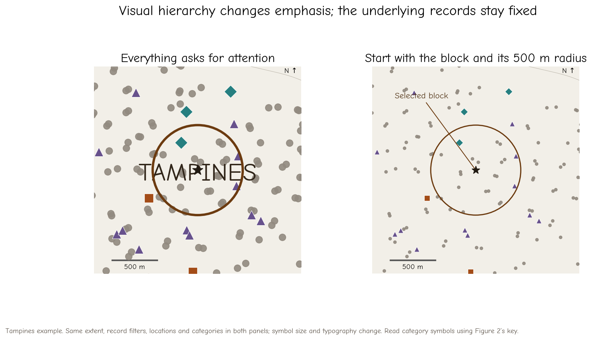
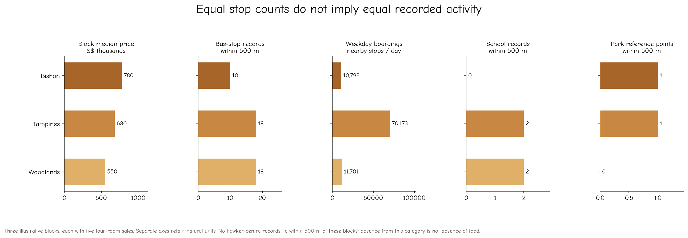

# 7.3 Visual hierarchy within a figure and across a sequence

Visual hierarchy is the order in which a reader is likely to notice information. Size, contrast, position, whitespace and alignment all influence that order. The design task is to make the important comparison easy to find without making the supporting evidence disappear.

## Give each view one main job

In a local map, the block and its search boundary should be easy to locate. Planning-area edges provide context. Bus stops and POIs provide evidence. If every element has a heavy outline, a bright colour and a large label, the reader must reconstruct that hierarchy unaided.

*Figure 7.3. An original design comparison using identical records, filtering and extent. The left panel uses large symbols and a competing place label. The right reduces competing emphasis and labels the analytical anchor. Neither design changes the observations; the category key is shared with Figure 7.2.*

The right panel is easier to enter, but it is not automatically the correct design for every question. A story about the distribution of schools might emphasise school symbols instead. Hierarchy is a choice about the reader's task. It becomes misleading when a designer makes an inconvenient observation nearly invisible or treats visual prominence as evidence of importance.

## Use charts when the comparison is numerical

Maps show location well. They are less effective when readers must compare several exact quantities at once. After orienting the reader with the local maps, we can align the same blocks in a small-multiple chart. Each panel has its own axis and unit; rows remain in a fixed order.

*Figure 7.4. The same three blocks in every panel, using a 500 m radius for nearby records. The price panel describes five observed four-room sales per block. The boarding panel sums average weekday boardings at qualifying stops, rather than counting residents or unique travellers. Panel lengths must be read against their own axes.*

The selected Tampines and Woodlands blocks each have **18 nearby bus-stop records**. Yet their nearby stops record about **70,173 and 11,701 weekday boardings per day**, respectively. A stop serving a busy interchange or destination can carry much more activity than a residential stop. These data do not establish why the difference occurs; they show that equal stop counts need not correspond to equal recorded activity.

The Bishan block has 10 nearby stops and about 10,792 weekday boardings. Its five observed sales have a median price of S\$780,000, compared with S\$680,000 at the Tampines block and S\$550,000 at the Woodlands block. These three observations do not show how price responds to transport or amenities. Floor area, remaining lease, storey, location and many unmeasured attributes also matter. Nor does a higher observed price establish whether a home is affordable for a particular household.

## Sequence creates a second hierarchy

A figure has an internal reading order; a chapter has an order across figures. The national overview establishes scope. Local maps make the spatial operation visible. Aligned charts reveal a contrast that is hard to estimate from symbols. A sensitivity chart then prevents that contrast from becoming the final, unquestioned answer.

This sequence is more useful than placing every available layer on the first map. Each view answers a question raised by the preceding view. Repetition helps when the locations, row order, symbols and terms remain stable. Repetition becomes wasteful when a new map adds no new inference or merely decorates a result already explained.

A strong headline can guide this progression: “Equal stop counts do not imply equal recorded activity.” A stronger-sounding headline such as “Busy bus stops make homes expensive” would add a causal claim absent from the analysis. Good hierarchy highlights the checked finding; it does not strengthen the finding itself.

**Try it.** Give Figure 7.4 two alternative titles: one for a student learning measurement, one for a planner reviewing data gaps. Both titles must remain true of the displayed data.
